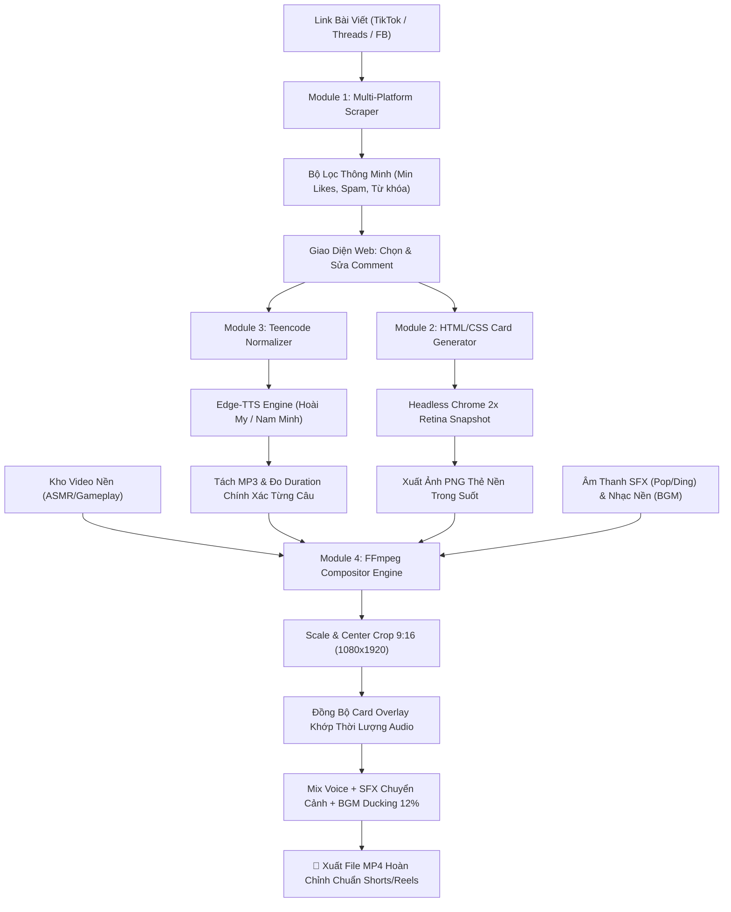

# 🎬 Social Video Automation Studio (Shorts / Reels / TikTok)

Hệ thống tự động hóa toàn diện sản xuất video ngắn dạng 9:16 (1080x1920) từ bài đăng và bình luận mạng xã hội (Threads, TikTok, Facebook).

---

## 🏗 1. KIẾN TRÚC HỆ THỐNG & TECH STACK ĐỀ XUẤT

| Thành phần | Công nghệ lựa chọn | Lý do tối ưu |
| :--- | :--- | :--- |
| **Backend & API** | **FastAPI + Uvicorn (Python 3.10+)** | Bất đồng bộ (Async/Await), hiệu năng cao, tích hợp OpenAPI documentation, dễ dàng scale. |
| **Cào dữ liệu & Bộ lọc** | **Playwright / BeautifulSoup + Regex Filter** | Vượt Cloudflare/Bot-detection, cào DOM linh hoạt, hỗ trợ bộ lọc like tối thiểu & khử link spam. |
| **UI Card Renderer** | **Headless Chrome (Selenium) + TailwindCSS + Jinja2** | Tái tạo pixel-perfect giao diện Threads/TikTok/FB với tỉ lệ 2x/3x Retina, khử răng cưa và xuất ảnh PNG nền trong suốt. Tránh vỡ nét như chụp màn hình thông thường. |
| **Giọng đọc (TTS)** | **Microsoft Edge-TTS + gTTS Fallback** | Giọng đọc AI tiếng Việt chuẩn tự nhiên nhất hiện nay (`vi-VN-HoaiMyNeural`, `vi-VN-NamMinhNeural`), hoàn toàn miễn phí, không giới hạn ký tự. |
| **Bộ chuyển Teencode** | **Custom Regex & Slang Dictionary Engine** | Chuyển đổi toàn diện từ viết tắt tiếng Việt ("ko", "đc", "cmt", "10k", "vcl") trước khi nạp vào TTS. |
| **Video Compositor Engine** | **FFmpeg Pipeline (via `imageio-ffmpeg`)** | Tránh rò rỉ bộ nhớ (Memory Leak) và giật khung hình của MoviePy. Tự động crop 9:16 thông minh, đồng bộ audio TTS, hiệu ứng pop-in fade, chèn tiếng "pop" SFX và nhạc nền BGM ducking. |
| **Frontend Web Studio** | **HTML5 + TailwindCSS + Vanilla JS** | Giao diện Dark/Light hiện đại, xem trước card trực quan, nghe thử TTS từng câu, chọn bình luận theo ý muốn. |

---

## 🔄 2. SƠ ĐỒ LUỒNG DỮ LIỆU (DATA PIPELINE)



---

## 🛠 3. CÁC LỖI KINH ĐIỂN ĐÃ ĐƯỢC XỬ LÝ TRIỆT ĐỂ

1. **Lỗi thiếu FFmpeg trong PATH Windows**: 
   - Hệ thống tự động phát hiện `imageio_ffmpeg.get_ffmpeg_exe()`, tự động cấu hình đường dẫn binary mà không yêu cầu người dùng phải cấu hình biến môi trường thủ công.
2. **Lỗi font chữ tiếng Việt bị "Tofu" / Ô vuông**:
   - Sử dụng Google Fonts `Be Vietnam Pro` và `Inter` với đầy đủ bộ ký tự có dấu (`ơ`, `ư`, `ạ`, `ả`, `ề`, `ố`), đảm bảo thẻ bình luận hiển thị sắc nét 100%.
3. **Lỗi lệch nhịp Audio & Video (Sync Drift)**:
   - Đo thời lượng duration chính xác đến từng mili-giây qua metadata stream của FFmpeg, cộng đệm nhịp thở (0.15s), loại bỏ tình trạng câu nói bị cắt cụt.
4. **Lỗi Rate Limit / WebSocket Timeout của Edge-TTS**:
   - Sử dụng cơ chế Semaphore tuần tự + tự động thử lại 3 lần + Fallback sang Google TTS (`gTTS`) nếu mạng gián đoạn.
5. **Lỗi thiếu file âm thanh SFX hoặc Video mẫu**:
   - Tích hợp bộ sinh âm thanh toán học (`sfx_generator.py`) tự tạo ra tiếng bubble pop (`pop.wav`), chuông ding (`ding.wav`), bản nhạc chill ambient Cmaj7 (`chill_bgm.wav`) và video mẫu 1080x1920 gradient, giúp tool chạy ngay tức thì mà không cần tải tài nguyên ngoài.

---

## 🚀 4. HƯỚNG DẪN KHỞI CHẠY (QUICK START)

### Bước 1: Cài đặt thư viện
```bash
pip install -r requirements.txt
```

### Bước 2: Khởi động Studio
```bash
python run.py
```
Truy cập trình duyệt: **`http://localhost:8000`**

---

## 📁 5. CẤU TRÚC DỰ ÁN

```
social-video-generator/
├── app/
│   ├── config.py             # Cấu hình hệ thống
│   ├── teencode.py           # Bộ từ điển chuyển đổi Teencode & Regex
│   ├── scraper.py            # Cào dữ liệu đa nền tảng & mock viral datasets
│   ├── renderer.py           # Render ảnh PNG thẻ bình luận 2x Retina bằng Chrome
│   ├── tts_engine.py         # Tổng hợp giọng đọc Edge-TTS tiếng Việt
│   ├── compositor.py         # Engine FFmpeg ghép video 9:16 + SFX + BGM
│   ├── sfx_generator.py      # Tự sinh SFX Pop, Ding, BGM và Video nền mẫu
│   └── main.py               # FastAPI Backend REST API
├── templates/
│   ├── threads_card.html     # Mẫu thẻ Threads (Dark / Light)
│   ├── tiktok_card.html      # Mẫu thẻ TikTok (Dark / Light)
│   └── facebook_card.html    # Mẫu thẻ Facebook (Dark / Light)
├── static/
│   ├── index.html            # Giao diện Studio Web App
│   └── app.js                # Logic điều khiển giao diện
├── assets/                   # Kho tài nguyên SFX, BGM, Video nền
├── output/                   # Nơi lưu thẻ PNG, audio MP3 và video MP4
├── requirements.txt
└── run.py                    # Script chạy 1-click
```
